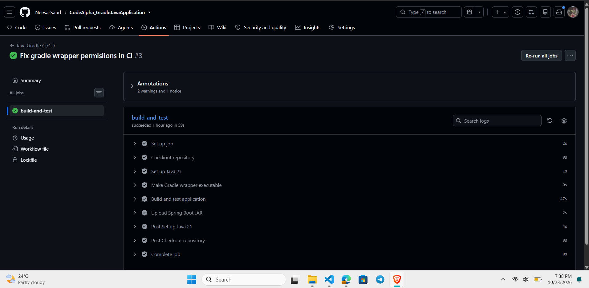
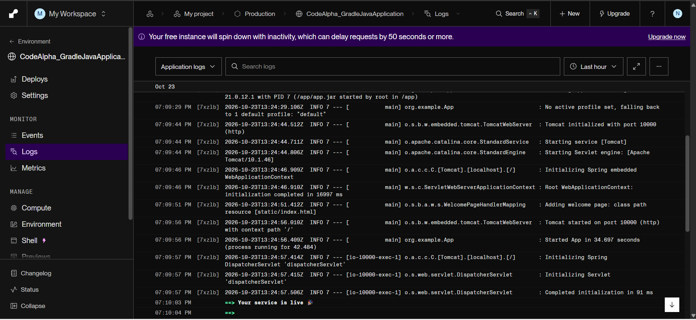
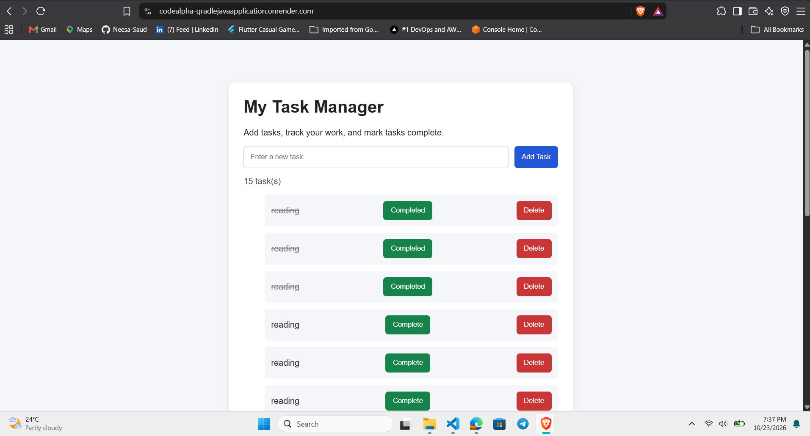

# Java Application Using Gradle

This project was developed as part of my **CodeAlpha Internship — Task 3**. The main purpose was to learn how Gradle can be used to build a Java application and how DevOps tools can help automate the build and deployment process.

While working on this task, I used Gradle for building the application, GitHub Actions for automated builds and tests, Docker to package the application, and Render to deploy it.

## Technologies I Used

- Java 21
- Spring Boot
- Gradle
- Git and GitHub
- GitHub Actions
- Docker
- Render

## What I Worked On

During this task, I worked on the following:

- Used Gradle to build the Java application and manage its dependencies.
- Created a GitHub Actions workflow to run the Gradle build and tests automatically.
- Configured the workflow to upload the generated Spring Boot JAR as an artifact.
- Created a Dockerfile to build and run the application inside a container.
- Deployed the application on Render and enabled automatic deployment when changes are pushed to GitHub.

This helped me understand how different tools work together during application development and deployment.

## How to Run the Project Locally

### Prerequisites

- Java JDK 21
- Git

### 1. Clone the repository

```powershell
git clone <YOUR_GITHUB_REPOSITORY_URL>
cd <YOUR_PROJECT_DIRECTORY>
```

Replace the placeholders with your repository URL and project folder name.

### 2. Build the application

On Windows, run:

```powershell
.\gradlew.bat build
```

This runs the Gradle build and the tests configured in the project.

### 3. Run the application

If the `app` module generates an executable Spring Boot JAR, run:

```powershell
java -jar .\app\build\libs\<YOUR_JAR_FILE>.jar
```

Replace the placeholder with the actual JAR filename generated by Gradle.

## GitHub Actions Workflow

I created a GitHub Actions workflow that runs when I push changes to the `main` branch or create a pull request targeting `main`.

The workflow:

1. Checks out my code from GitHub.
2. Sets up Java 21.
3. Configures Gradle dependency caching.
4. Runs the Gradle build and tests.
5. Uploads the generated JAR as an artifact.

This helped me learn how to automate the build process instead of running every step manually.

## Docker

I created a Dockerfile using a multi stage build.

The first stage uses the Java JDK to build the application with Gradle. The second stage uses the Java runtime image to run the generated JAR.

This separates the build environment from the runtime environment and avoids including the full JDK in the final image.

## Deployment on Render

I deployed the application to Render using my Dockerfile. I also enabled automatic deployment so that Render can deploy new commits from my configured GitHub branch.

**Live application:** <YOUR_RENDER_URL>

## What I Learned

Through this task, I got practical experience with:

- Building a Java application using Gradle.
- Managing dependencies through a Gradle build file.
- Running builds and tests automatically with GitHub Actions.
- Creating a Docker image for a Java application.
- Deploying an application on Render.
- Understanding how CI and CD fit into a development workflow.

This task helped me connect the tools I had been learning and understand how they can be used together in a real project.

## Task Information

- **Internship:** CodeAlpha
- **Task:** Task 3 — Java Application Using Gradle

## Screenshots

### GitHub Actions



### Render Deployment



### Live Application



## Live Demo

The application is deployed on Render and can be accessed here:

🔗 **Live Application:** [Open Task Manager](https://codealpha-gradlejavaapplication.onrender.com/)
